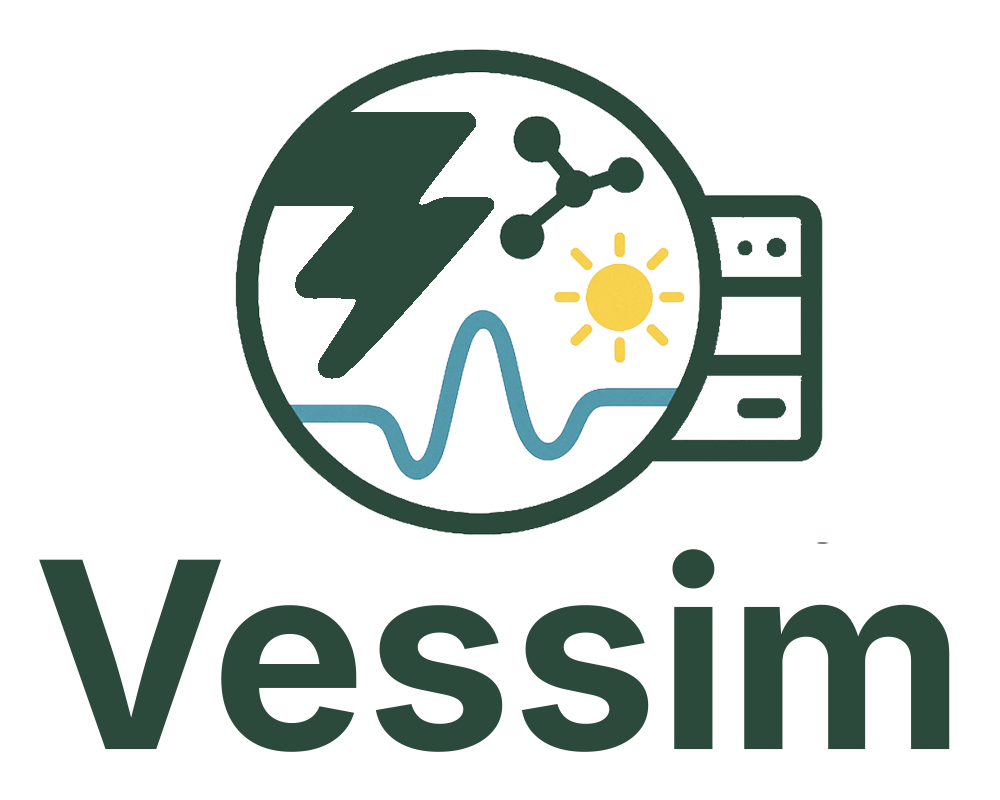

<p align="center">
    
</p>

Vessim is a Python library for simulating datacenter energy systems.

Vessim models the interaction between datacenter demand and energy infrastructure, helping you understand how design and control decisions affect cost, carbon emissions, and resilience.

[Documentation](https://vessim.readthedocs.io/en/latest/) · [Getting started](https://vessim.readthedocs.io/en/latest/getting_started/) · [Explore example results](https://vessim.readthedocs.io/en/latest/vessim_viewer/)

- **Simulation studies:** Compare infrastructure and control strategies across demand, weather, and operating scenarios.
  Explore design choices through parameter sweeps, optimization, or probabilistic simulations.
- **Live modeling:** Connect real applications to a simulated energy system through REST APIs.
  Test how a scheduler or controller responds to changing power availability.
- **Digital twins:** Model an energy system alongside the real installation using live measurements.
  Explore possible futures, such as prolonged low renewable generation or a grid outage.

## Getting started

Install Vessim with Python 3.9 to 3.15:

```console
python -m pip install vessim
```

This example models three days of datacenter demand, solar generation, and battery operation.
Surplus solar power charges the battery, which supplies demand when solar generation falls.
The grid supplies any remaining deficit and receives surplus power once the battery is full.

Download [solar_example.csv](https://raw.githubusercontent.com/dos-group/vessim/main/datasets/solar_example.csv) into your working directory, then run:

```python
import vessim as vs

# Scale the solar profile to a 2.4 kW installation.
solar = vs.Trace.from_csv("solar_example.csv", column="Berlin", scale=2400)

env = vs.Environment(sim_start="2026-01-01", step_size=5 * 60)
env.add_microgrid(
    name="site",
    actors=[
        vs.Consumer("load", signal=700),
        vs.Producer("solar", signal=solar),
    ],
    dispatchables=[vs.SimpleBattery("battery", capacity=1000), vs.GridConnection()],
)
recorder = env.add_controller(vs.Recorder("results/basic_example"))
env.run(until=3 * 24 * 3600)

metrics = recorder.metrics["microgrids"]["site"]
print(f"Grid import: {metrics['grid_import'] / 1000:.2f} kWh")
print(f"Grid export: {metrics['grid_export'] / 1000:.2f} kWh")
```

```text
Grid import: 26.71 kWh
Grid export: 11.08 kWh
```

[Explore this example in your browser](https://vessim.readthedocs.io/en/latest/viewer/index.html?study=getting-started#results), or open your saved results locally:

```console
python -m vessim view results/basic_example
```

The [Getting Started walkthrough](https://vessim.readthedocs.io/en/latest/getting_started/) explains how the components work together.
To use your own data, see [Actors and Signals](https://vessim.readthedocs.io/en/latest/concepts/signals/).

## Explore further

| Example | What you can explore |
| --- | --- |
| [Equipment sizing](examples/infrastructure_study.py) | Compare wind, solar, and battery configurations over a year. [View results](https://vessim.readthedocs.io/en/latest/viewer/index.html?study=infrastructure-year#results) |
| [Optimization](https://vessim.readthedocs.io/en/latest/concepts/optimization/) | Search for designs with different cost and emissions trade-offs. [View results](https://vessim.readthedocs.io/en/latest/viewer/index.html?study=optuna-search#results) |
| [Dispatch strategies](examples/strategy_comparison.py) | Compare control policies across demand scenarios. [View results](https://vessim.readthedocs.io/en/latest/viewer/index.html?study=dispatch-comparison#results) |
| [Multiple microgrids](examples/microgrid_comparison.py) | Model several sites and compare equipment choices. [View results](https://vessim.readthedocs.io/en/latest/viewer/index.html?study=multiple-microgrids#results) |
| [Demand response](examples/demand_response.py) | Adjust workload concurrency under a flexible grid connection agreement |
| [Custom metrics](examples/custom_metrics.py) | Calculate electricity costs, emissions, and your own study objectives |

For [live measurements and REST control](https://vessim.readthedocs.io/en/latest/concepts/live/), install `pip install 'vessim[live]'` and use `vs.Environment.live()`.
To [connect external simulators](https://vessim.readthedocs.io/en/latest/concepts/coupling/) through Mosaik, install `pip install 'vessim[mosaik]'`.

## Contributing

Share feedback, ideas, or questions on [GitHub Discussions](https://github.com/dos-group/vessim/discussions).
For development, install `pip install -e '.[dev,docs,live,mosaik]'` from a checkout and run `make check`.
Use `make serve-docs` to preview the documentation and example viewer.

## Publications

If you use Vessim in your research, please cite:

Philipp Wiesner, Ilja Behnke, Paul Kilian, Marvin Steinke, and Odej Kao.
[**Vessim: A Testbed for Carbon-Aware Applications and Systems.**](https://dl.acm.org/doi/pdf/10.1145/3727200.3727210)
*ACM SIGENERGY Energy Informatics Review 4 (5)*, 2024.

For the software-in-the-loop methodology, see [Software-in-the-Loop Simulation for Developing and Testing Carbon-Aware Applications](https://doi.org/10.1002/spe.3275).
More papers and applications are listed in the [documentation](https://vessim.readthedocs.io/en/latest/publications/).

## About

Vessim is developed at the [Machine Learning Systems Lab](https://mlsys.cst.cam.ac.uk/) at the [University of Cambridge](https://www.cam.ac.uk/).
