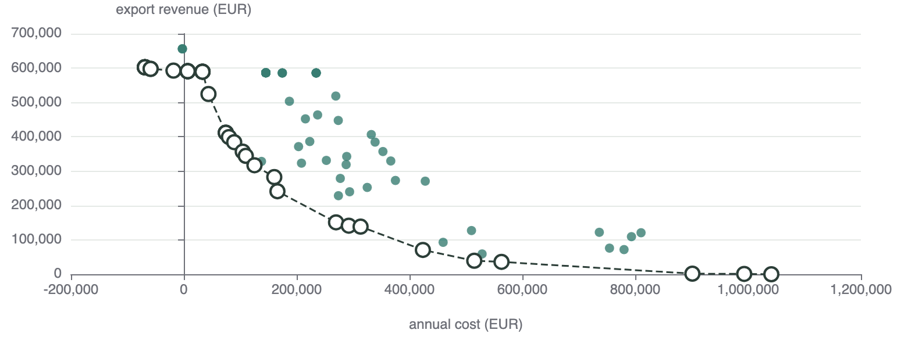

# Simulation studies

Define scenarios in Python and compare their [recorded metrics](results.md) and time series in the [viewer](../vessim_viewer.md).
These three examples use synthetic inputs. Follow the [setup instructions](https://github.com/dos-group/vessim/blob/main/examples/README.md) to run them locally.

## Exploring microgrid configurations

Adding wind, solar, and battery storage can reduce a datacenter's grid imports, but manufacturing the equipment also causes emissions.
We compare eight setups over a full year to see how equipment choices affect grid dependence and emissions.

The setups include grid-only supply, solar, wind, a wind–solar mix, and four combinations with storage, all facing the same demand and weather.
Compare their energy and emissions metrics, then overlay time series to see when batteries charge and grid supply is needed.

[Explore the results](../viewer/index.html?study=infrastructure-year#results) or run the [infrastructure example](https://github.com/dos-group/vessim/blob/main/examples/infrastructure_study.py):

```console
python examples/infrastructure_study.py
python -m vessim view results/infrastructure-study
```

## Optimization with Optuna

Design spaces can be very large, while we often only need configurations that perform well against specific metrics.
Optuna uses results from previous simulations to guide the search toward promising designs without evaluating every possible combination.

Here, we optimize wind, solar, and battery sizing to minimize annual cost and grid-import emissions.
Optuna selects 100 candidates, Vessim simulates each for a year, and the viewer shows their cost–emissions trade-offs and time series.

<figure class="vessim-figure" markdown="1">

  

  <figcaption>Annual cost and export revenue for the evaluated configurations, shown in the Vessim viewer.</figcaption>
</figure>

[Explore the results](../viewer/index.html?study=optuna-search#results) or run:

```console
python examples/infrastructure_study.py --financial --trials 100 --output results/infrastructure-search
python -m vessim view results/infrastructure-search
```

See [Optimization](optimization.md) for defining an objective function and using Optuna Dashboard to inspect the search.

## Probabilistic studies

Demand, weather, and electricity prices are uncertain.
Monte Carlo sampling lets us evaluate configurations across possible realizations of these inputs and examine how their outcomes vary.

This example samples demand and compares three battery strategies: self-consumption, peak shaving, and carbon-aware charging.
Each faces the same five daily demand samples. Compare individual runs or aggregate them to see the variation in costs, emissions, and peak grid imports.

[Explore the results](../viewer/index.html?study=dispatch-comparison#results) or run the [dispatch example](https://github.com/dos-group/vessim/blob/main/examples/strategy_comparison.py):

```console
python examples/strategy_comparison.py
python -m vessim view results/strategy-comparison
```

We are working on better functionality for planning, executing, and visualizing probabilistic studies.
