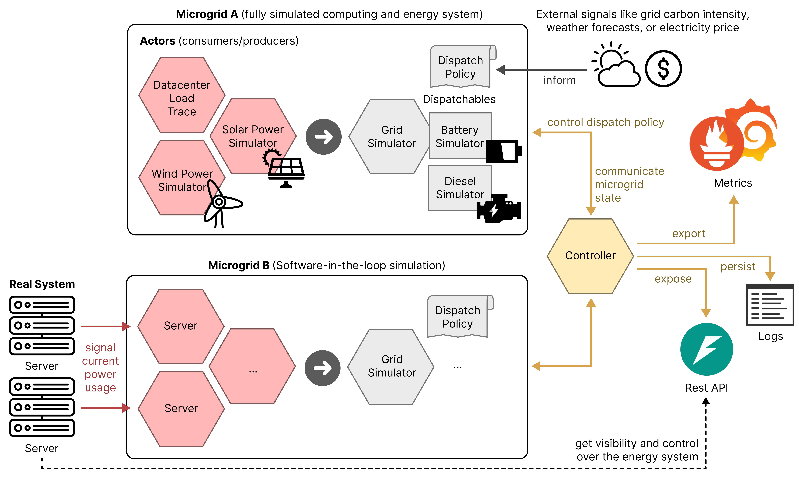

# Getting started

## Install

Install Vessim with Python 3.9 to 3.15:

```console
python -m pip install vessim
```

Optional integrations:

| Install | Use |
| --- | --- |
| `pip install 'vessim[live]'` | [Live measurements and REST APIs](concepts/live.md) |
| `pip install 'vessim[mosaik]'` | [Connect external simulators](concepts/coupling.md) |

## How Vessim works

Vessim models local energy systems, called *microgrids*.
Each combines electrical loads, such as computing equipment and cooling, with generation, storage, and grid connections.
An [environment](#run-your-first-simulation) advances one or more microgrids on a shared clock, for example to model geographically distributed datacenters.



- **[Actors](concepts/signals.md)** (red) provide demand and generation.
  [`vs.Consumer`](api_reference/actor.md#vessim.Consumer) and [`vs.Producer`](api_reference/actor.md#vessim.Producer) use static inputs or a [signal](concepts/signals.md), such as a load trace or live measurement.
  Their combined power gives the surplus or deficit to balance at each step.
- **[Dispatchables](concepts/dispatchables.md)** (gray) supply or absorb power within their operating limits.
  A [dispatch policy](concepts/dispatchables.md#dispatch-policies) allocates the surplus or deficit across batteries, generators, and grid connections.
  Policies can use electricity prices or carbon intensity to guide those decisions.
- **[Controllers](concepts/controllers.md)** (yellow) observe all microgrids after dispatch.
  They can change demand or policy parameters for subsequent steps, [record results](concepts/results.md), or let external applications monitor and control the system through a [REST API](concepts/live.md#connect-an-application).

## Run your first simulation

The following steps build a three-day experiment with a datacenter load, solar generation, and battery storage.
The complete script is available as [basic_example.py](https://github.com/dos-group/vessim/blob/main/examples/basic_example.py).

### 1. Choose how to run

| Create an environment with | To |
| --- | --- |
| `vs.Environment(...)` | Run as fast as computation allows for [simulation studies](concepts/studies.md) |
| `vs.Environment.live(...)` | Run alongside wall-clock time for [live applications and measurements](concepts/live.md) |

Both modes use the same component models.
Here we use simulation mode and update the system every five minutes:

```python
import vessim as vs

env = vs.Environment(sim_start="2026-01-01", step_size=5 * 60)
```

### 2. Assemble the energy system

Add demand, generation, and the resources that supply or store power to a microgrid.
Download [solar_example.csv](https://raw.githubusercontent.com/dos-group/vessim/main/datasets/solar_example.csv) into your working directory.
Its first column contains elapsed seconds and the remaining columns contain normalized solar profiles for different cities.
Here we select Berlin and scale its profile to a 2.4 kW installation, alongside a constant 700 W load, a 1 kWh battery, and the public grid:

```python
# Scale the normalized solar profile to a 2.4 kW installation.
solar = vs.Trace.from_csv("solar_example.csv", column="Berlin", scale=2400)

env.add_microgrid(
    name="site",
    actors=[
        vs.Consumer("load", signal=700),
        vs.Producer("solar", signal=solar),
    ],
    dispatchables=[vs.SimpleBattery("battery", capacity=1000), vs.GridConnection()],
)
```

The default policy uses the battery before exchanging power with the grid.
Choose different [inputs](concepts/signals.md) or [resources and policies](concepts/dispatchables.md) to represent your system.
Call `add_microgrid()` again to model another site.

### 3. Add recording or control

Register a `Recorder` to save results:

```python
recorder = env.add_controller(vs.Recorder("results/basic_example"))
```

Add [custom controllers](concepts/controllers.md) to adjust demand or resource operation as the simulation progresses.
Controllers can observe all sites in the environment.

### 4. Run and inspect

Run the model for three simulated days:

```python
run = env.run(until=3 * 24 * 3600)
metrics = recorder.metrics["microgrids"]["site"]
print(f"Grid import: {metrics['grid_import'] / 1000:.2f} kWh")
print(f"Grid export: {metrics['grid_export'] / 1000:.2f} kWh")
```

```text
Grid import: 26.71 kWh
Grid export: 11.08 kWh
```

Open the saved results:

```console
python -m vessim view results/basic_example
```

[Explore this example in the viewer](viewer/index.html?study=getting-started#results), or open [Time series](viewer/index.html?study=getting-started#timeseries) and select the basic example to inspect its power flows.

## Where next

| To… | Read |
| --- | --- |
| Use your own demand and generation data | [Load a CSV](concepts/signals.md#load-a-csv) |
| Model resource limits and outages | [Dispatchables and policies](concepts/dispatchables.md#grid-connections) |
| Implement control strategies or demand response | [Controllers](concepts/controllers.md) |
| Calculate costs, emissions, or custom metrics | [Results and metrics](concepts/results.md#costs-and-emissions) |
| Compare configurations and uncertain scenarios | [Simulation studies](concepts/studies.md) and [optimization](concepts/optimization.md) |
| Test an application against a simulated energy system | [Live simulation](concepts/live.md#connect-an-application) |
| Model an existing energy system using live measurements | [Digital-twin workflows](concepts/live.md#build-a-digital-twin) |
| Connect another simulator | [Connect external simulators](concepts/coupling.md) |
